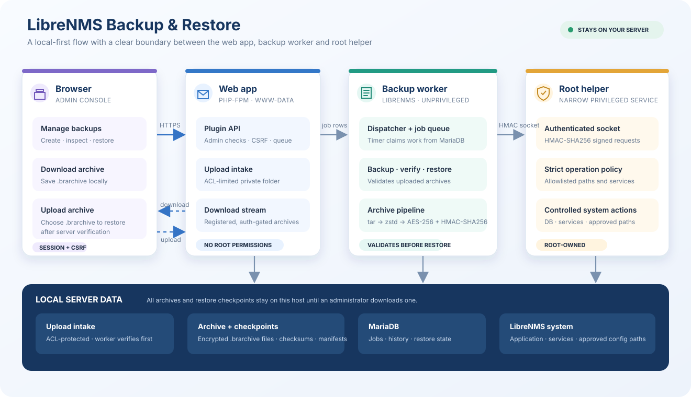

# LibreNMS Backup & Restore

Encrypted, verified, component-aware backups for LibreNMS — with a restore path
that has actually been rehearsed.

The usual LibreNMS backup advice is a cron job running `mysqldump` and a `tar` of
the install directory. That protects you against almost nothing: nobody tests the
restore, the dump is unencrypted on the same disk, and a half-written archive
looks identical to a good one until the day you need it.

This plugin treats the backup as a product: it is encrypted, it is verified at
three levels, every restore is preceded by a recovery checkpoint, and the restore
itself cannot leave your database empty if it fails.

## Install and set up

Follow these steps on the Linux server that already runs LibreNMS. You need an
administrator account that can use `sudo`. The commands below assume LibreNMS
is installed at `/opt/librenms` and that the LibreNMS service account is named
`librenms`.

### 1. Install the required packages

On Ubuntu or Debian, run:

```bash
sudo apt-get update
sudo apt-get install -y git python3 python3-pymysql python3-cryptography \
                        zstd mariadb-client rsync acl
```

### 2. Download the project

Choose one of these download options:

**Release tarball:** when available, download the release archive named
`librenms-backup-restore-1.0.3.tar.gz` from the
[GitHub Releases](https://github.com/Santhosh2605/librenms-backup-restore/releases)
page and unpack it:

```bash
tar -xzf librenms-backup-restore-1.0.3.tar.gz
cd librenms-backup-restore-1.0.3
```

**GitHub ZIP:** choose **Code → Download ZIP** on GitHub. The ZIP is named
`librenms-backup-restore-main.zip` and extracts into a folder ending in `-main`.
Use that folder name in commands. ZIP downloads do not preserve executable
permissions, so restore them before running a script directly:

```bash
unzip librenms-backup-restore-main.zip
cd librenms-backup-restore-main
chmod +x scripts/*.sh
```

**Git clone:**

```bash
cd /tmp
git clone https://github.com/Santhosh2605/librenms-backup-restore.git
cd librenms-backup-restore
```

### 3. Run the installer

```bash
sudo bash scripts/install.sh
```

When asked `Continue? [y/N]`, type `y` and press Enter. The installer adds the
plugin to LibreNMS, creates its database tables and encryption key, and enables
the background services. It does not replace LibreNMS itself.

If LibreNMS is installed somewhere other than `/opt/librenms`, pass its path:

```bash
sudo LIBRENMS_ROOT=/srv/librenms bash scripts/install.sh
```

### 4. Save the encryption key off the server

The installer uses AES-256 encryption authenticated with HMAC-SHA256 and creates:

```text
/etc/librenms-backup/keys/passphrase
```

Copy the file into a secure password manager or other safe offline storage.
**You need this passphrase to decrypt your backups.** Never commit it to GitHub
or leave your only copy on the LibreNMS server. Do not replace it after backups
have been created. Existing `age` archives remain readable with their original
`identity.txt` key; keep that key if you have older archives.

### 5. Open the plugin and make a backup

1. Sign in to LibreNMS with an administrator account.
2. Open **Plugins → Backup & Restore**.
3. Choose **Run Full Backup Now** and wait for the job to complete.
4. Verify that the backup is marked **verified**.
5. Rehearse a restore on a test or staging server before relying on backups for
   recovery.

To save an archive to your computer, open **Backup History** and choose
**Download**. To restore an archive that is on your computer, open **Restore**,
choose the `.brarchive` file under **Add a backup to this server**, and select
**Upload and verify**. After verification completes, select that backup and run
the pre-flight checks before confirming the restore. Uploads remain on the
server; they are never sent to an external storage service.

The installer grants the PHP-FPM account access only to the upload intake
folder. It assumes the web account is `www-data`; for a custom PHP-FPM user,
install with `sudo WEB_USER=<php-fpm-user> bash scripts/install.sh`.

If the menu item does not appear, refresh LibreNMS's cached plugin list:

```bash
sudo -u librenms php /opt/librenms/artisan config:clear
```

For restore and recovery instructions, see [RESTORE.md](docs/RESTORE.md).

### Installation reference

#### Requirements

The installer targets Ubuntu 26.04 with PHP 8.5 and is also validated on Debian
13 with PHP 8.4. The server needs LibreNMS, Python 3.11 or newer, PHP 8.2 or
newer, MariaDB 10.6 or newer, systemd 245 or newer, and `zstd`. Install the
required packages on Ubuntu or Debian with:

```bash
sudo apt-get update
sudo apt-get install -y git python3 python3-pymysql python3-cryptography \
                        zstd mariadb-client rsync acl
```

#### Download as a ZIP or release tarball

The clone command above is the simplest option. To install without Git, download
the ZIP from GitHub's **Code → Download ZIP** menu, copy it to the server, then
extract it:

```bash
sudo apt-get install -y unzip
cd /tmp
sudo unzip -o ~/librenms-backup-restore-main.zip
cd /tmp/librenms-backup-restore-main
sudo chmod +x scripts/*.sh
sudo bash scripts/install.sh
```

GitHub names the extracted folder `librenms-backup-restore-main`; release
tarballs use a versioned folder name, for example
`librenms-backup-restore-1.0.2.tar.gz`. Unpack a downloaded release tarball
with `sudo tar -xzf librenms-backup-restore-1.0.2.tar.gz -C /opt/`, then
continue from its extracted directory. ZIP files do not preserve executable
permissions, so run `chmod +x` before running scripts directly.

#### Ubuntu 26.04 sudo compatibility

Ubuntu 26.04 uses sudo-rs, which rejects some sudoers `Defaults` options. The
installer validates its policy before installing it and falls back to a minimal
policy if needed. To check the system manually, run:

```bash
sudo -V | head -2
sudo visudo -c -f /etc/sudoers.d/librenms-backup
```

`sudo-rs` in the version output is expected on Ubuntu 26.04.

#### Configure and protect the encryption key

The installer creates `/etc/librenms-backup/br.conf` and does not overwrite an
existing configuration. It defaults to AES-256 encryption authenticated with
HMAC-SHA256 and `zstd` compression. To change settings, edit that file as root;
for example, set `librenms_root` under `[general]`, `compression` under
`[archive]`, or disable RRD collection under `[components]`. Do not put secrets
in `br.conf`.

The generated passphrase is stored at
`/etc/librenms-backup/keys/passphrase`. Keep it in secure offline storage; it is
needed to decrypt backups after a server loss. Keep the matching `identity.txt`
too if you have older `age`-encrypted archives. Never replace a key used by
existing backups.

#### Ownership and web upload limits

The code under `/opt/librenms-backup-restore` is root-owned so the worker cannot
change its own code. The installer manages the remaining owners and permissions:
the worker runs as `librenms`, while PHP-FPM receives write access only to the
archive upload intake folder. The web account defaults to `www-data`; for a
different PHP-FPM account, install with:

```bash
sudo WEB_USER=<php-fpm-user> bash scripts/install.sh
```

For uploads larger than the PHP defaults, raise `upload_max_filesize` and
`post_max_size` above your largest archive (the plugin limit is 50 GiB). If
nginx fronts PHP-FPM, also raise `client_max_body_size`, then restart PHP-FPM
and the web server.

#### Start and verify services

The installer enables the helper and background timers. Check them and run the
installation validator with:

```bash
sudo systemctl status br-helper.service --no-pager
sudo systemctl list-timers 'librenms-backup-*'
sudo bash /opt/librenms-backup-restore/scripts/validate-install.sh
```

The plugin dashboard should report `helper: reachable`. If the menu is missing,
clear LibreNMS's cached plugin list using the command in the setup steps above.

#### Troubleshooting

| Symptom | Suggested check or fix |
|---|---|
| `helper: unreachable` | Restart `br-helper.service`; check permissions under `/run/librenms-backup/`. |
| Jobs stay `queued` | Check `systemctl list-timers` and `journalctl -u librenms-backup-dispatch`. |
| `Can't create TCP/IP socket` during restore | Confirm `/run/mysqld/mysqld.sock` exists; the helper uses the local socket. |
| Plugin page or assets return 404 | Confirm `html/plugin-backuprestore.php` was installed and clear the LibreNMS config cache. |
| `Data too long for column 'retention_class'` | Run `sudo -u librenms php /opt/librenms-backup-restore/scripts/br-schema.php install`. |
| Restore fails at `RESTORING_DATABASE` | Review the restore `job.log` and verify the archive using the deep verification level. |

Logs are under `/var/log/librenms-backup/`; helper logs are available with
`sudo journalctl -u br-helper`. To uninstall while keeping archives and
configuration, run `sudo bash /opt/librenms-backup-restore/scripts/uninstall.sh`.
Add `--purge` only when you also want its data and configuration removed.

### Optional: LibreNMS database-validator compatibility patch

Some LibreNMS versions report this plugin's `br_*` tables as unexpected and
offer to drop them. MariaDB also reports the plugin's JSON columns with the
`utf8mb4_bin` collation. **Do not use LibreNMS's automatic database repair for
these warnings**; its suggested SQL can delete the plugin's tables.

The project includes a preparer that backs up the current LibreNMS validator
files and generates a reviewable patch without modifying LibreNMS core. From
the project checkout, run:

```bash
sudo python3 scripts/prepare_librenms_validator_patch.py --librenms-root /opt/librenms
```

The command prints a timestamped bundle directory under
`plugin/support/librenms-validator/`. Review its `README.txt`, saved files in
`backup/`, patched copies in `patched/`, and `librenms-validator-fix.patch`.
Select the newest generated bundle automatically:

```bash
PROJECT=/opt/librenms-backup-restore
BUNDLE=$(find "$PROJECT/plugin/support/librenms-validator" -mindepth 1 -maxdepth 1 -type d -name '????????T??????Z' -print | sort | tail -n 1)
test -n "$BUNDLE" && test -f "$BUNDLE/librenms-validator-fix.patch" || { echo "Validator patch bundle not found"; exit 1; }
printf 'Using bundle: %s\n' "$BUNDLE"
PATCH="$BUNDLE/librenms-validator-fix.patch"
sudo patch --dry-run -p1 -d /opt/librenms < "$PATCH"
```

Continue only if the dry run succeeds for every file. Applying the patch changes
LibreNMS core files and adds a validator helper. Then install the plugin's
schema manifest and set the new helper's owner:

```bash
sudo patch -p1 -d /opt/librenms < "$PATCH"
sudo install -o librenms -g librenms -m 0644 \
  /opt/librenms-backup-restore/plugin/librenms-schema.json \
  /opt/librenms/app/Plugins/BackupRestore/librenms-schema.json
sudo chown librenms:librenms /opt/librenms/LibreNMS/DB/PluginSchema.php
sudo -u librenms /opt/librenms/validate.php
```

The validator should then accept the declared plugin tables and JSON columns.
It will still report unrelated unexpected tables or actual collation problems.
LibreNMS will warn that these core files are locally modified. **Do not run
`lnms patch:remove --reset`**; it discards local patches, including the helper.

#### Updating LibreNMS later

Use the two scripts in order. The first script finds the bundle matching the
currently applied patch, saves the patched files and plugin manifest, restores
the original LibreNMS files, and runs LibreNMS's normal `daily.sh` update. It
stops without updating if it cannot match the installed patch to a saved bundle.

```bash
cd /opt/librenms-backup-restore
sudo bash scripts/pre-update-librenms-validator.sh
```

After `daily.sh` completes, run the second script. It prepares a new patch
against the updated LibreNMS files, dry-runs it, applies it only if the dry run
passes, and restores the saved plugin manifest. It also fixes the new helper's
ownership.

```bash
sudo bash scripts/post-update-librenms-validator.sh
```

The scripts keep a timestamped backup and a compressed copy under
`plugin/support/librenms-validator/update-backups/`. They never copy an old
patched LibreNMS file over a newer LibreNMS version. If patch preparation or
the dry run fails, the post-update script stops and leaves the new patch bundle
for review. If the pre-update script reports that `daily.sh` failed, resolve
the reported update issue and run the post-update script; it retries `daily.sh`
before preparing the new patch. Run validation afterward and decline automatic database repairs.
For common command and validation errors, see the
[LibreNMS validator patch troubleshooting guide](docs/LIBRENMS-VALIDATOR-TROUBLESHOOTING.md).

## What it does

- **Five components, selectable per run** — database, RRD, application, system,
  integrations. Back up everything, or just the config, or just the database.
- **Encrypted by default** — AES-256-CTR authenticated with HMAC-SHA256;
  keys are derived from the offline passphrase using PBKDF2-HMAC-SHA256.
- **Verified, not assumed** — `shallow` opens the container, `standard` checks
  every member's SHA-256, `deep` additionally gunzips the SQL dump and checks its
  schema statement and terminator.
- **Crash-safe restores** — the dump is imported into a scratch schema and
  promoted only after it succeeds. A failed restore cannot empty your database.
- **Rollback built in** — every restore first takes a verified recovery
  checkpoint, and retention never deletes one.
- **A real UI** — seven tabs: dashboard, history, manage, restore, scheduler,
  audit, settings. REST API underneath, so it is scriptable.

## Architecture

The browser talks to the web plugin, which queues work and accepts uploads only
into a dedicated ACL-protected intake folder. The unprivileged worker validates
uploads and handles archive storage. Only tightly scoped system actions pass
through the root helper.



### Component reference

| Component | Runs as | Responsibility | Code |
|---|---|---|---|
| **Admin UI** | browser | 7 tabs, REST calls, no server-side logic | `plugin/resources/views/` |
| **Front controller** | `www-data` | Boots LibreNMS's Laravel app and attaches the plugin's route table | `front-controller/` |
| **22 API routes** | `www-data` | Read endpoints, mutations, CSRF, `admin` gate | `plugin/Controllers/` |
| **Eloquent models** | `www-data` | The 7 `br_*` tables | `plugin/Models/` |
| **Dispatcher** | `librenms` | Timer-driven; claims queued jobs and spawns one worker each | `worker/br/worker.py` |
| **Worker** | `librenms` | Backup, verify, restore, retention | `worker/br/` |
| **Archive pipeline** | `librenms` | `tar → zstd → AES-256 + HMAC-SHA256 → BRENC1`, streaming, constant memory | `worker/br/writer.py`, `crypto.py` |
| **Root helper** | `root` | 20 operations over a unix socket, HMAC-signed | `worker/br/helper.py` |
| **Path allowlist** | `root` | Rejects traversal, `/` as a target, and anything outside the configured roots | `helper.py` (`PathPolicy`) |

### Data flow, in words

1. **Backup** — the UI `POST`s a request; the web tier writes one row to
   `br_jobs` and returns immediately. The dispatcher timer claims the row and
   starts a worker. The worker collects components, streams them through
   compression and encryption, writes the archive and its sidecars, verifies it,
   and records the result.
2. **Upload/download** — uploads land in the ACL-protected intake folder and
   the worker validates and verifies them before registration. Authorized admins
   can download registered archives through the plugin.
3. **Restore** — the UI `POST`s with a typed confirmation; preflight runs seven
   checks, then the worker drives the nine-stage state machine. Privileged steps
   (import the database, install trees, restart services) go through the helper.
   A verified checkpoint is taken before anything is modified.
4. **Verify** — retrieves the archive, checks the container, every member's
   SHA-256, and at `deep` level gunzips the SQL dump to confirm its schema
   statements and terminator.

## Why the privilege model is unusual

Most backup plugins give PHP-FPM a sudo rule, which turns any PHP RCE into root.
Here the web tier has **no root privilege**: it can queue jobs and write uploads
only to the restricted intake folder. Actual work happens in a worker running
as `librenms`, which can invoke exactly one command:

```sudoers
librenms ALL=(root) NOPASSWD: /usr/local/libexec/librenms-backup/br-helper
```

That helper speaks a closed JSON protocol over a unix socket, signs every message
with HMAC-SHA256, validates every field, and executes argv lists — never a shell.
See [docs/SECURITY.md](docs/SECURITY.md) for the full threat model, including what
it deliberately does *not* protect against.

## Documentation

| Document | Contents |
|---|---|
| [LIBRENMS-VALIDATOR-PATCH.md](docs/LIBRENMS-VALIDATOR-PATCH.md) | Prepare, review, and apply the optional LibreNMS schema-validator compatibility patch |
| [LIBRENMS-VALIDATOR-TROUBLESHOOTING.md](docs/LIBRENMS-VALIDATOR-TROUBLESHOOTING.md) | Troubleshoot patch bundle paths, apply errors, and validation results |
| [RESTORE.md](docs/RESTORE.md) | Restore runbook, rehearsal checklist, manual recovery, rollback |
| [SECURITY.md](docs/SECURITY.md) | Privilege model, helper protocol, secret handling, threat boundaries |
| [ARCHITECTURE.md](docs/ARCHITECTURE.md) | Process model, routes, data model, pipelines, failure modes |
| [SCHEDULER.md](docs/SCHEDULER.md) | Timers, job lifecycle, GFS retention |
| [CHANGELOG.md](docs/CHANGELOG.md) | Release notes and known limitations |

## Testing

```bash
python3 -m pytest                     # 115 unit tests, no services needed
```

Integration tests exercise the API contract and self-skip unless you point them
at a live instance:

```bash
export BR_TEST_BASE_URL=https://librenms.example.test
export BR_TEST_USER=admin BR_TEST_PASS='...'
python3 -m pytest tests/integration -v
```

## CLI

The worker is usable without the web UI, which matters when the UI is what is
broken:

```bash
python3 -m br.worker backup    --job <uuid> --type full
python3 -m br.worker verify    --job <uuid> --backup <archive> --level deep
python3 -m br.worker restore   --job <uuid> --restore <id> --backup <archive>
python3 -m br.worker retention --job <uuid>
python3 -m br.worker health
```

`BR_CONF` selects the configuration file (`/etc/librenms-backup/br.conf` by
default); `PYTHONPATH=/opt/librenms-backup-restore/worker`.

## Requirements

Python 3.11+ · PHP 8.2+ · MariaDB 10.6+ · systemd 245+ · `zstd`.
Validated on Debian 13 / PHP 8.4 / MariaDB 11.8 against LibreNMS `dd4cebd7`;
target platform is Ubuntu 26.04 / PHP 8.5.

## License

See [LICENSE](LICENSE).
