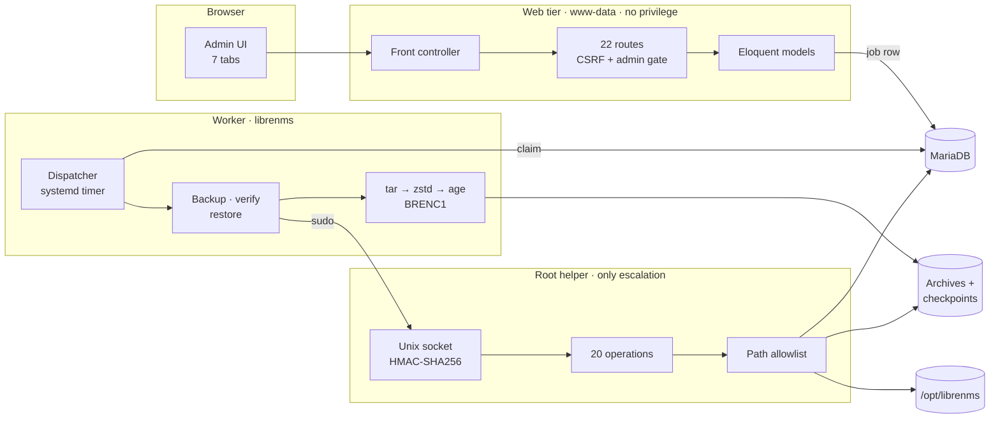

# LibreNMS Backup & Restore

Encrypted, verified, component-aware backups for LibreNMS — with a restore path
that has actually been rehearsed.

The usual LibreNMS backup advice is a cron job running `mysqldump` and a `tar` of
the install directory. That protects you against almost nothing: nobody tests the
restore, the dump is unencrypted on the same disk, and a half-written archive
looks identical to a good one until the day you need it.

This plugin treats the backup as a product: it is encrypted, it is verified at
three levels, every restore is preceded by a recovery checkpoint, and the restore
itself cannot leave your database empty if it fails.

## Install in one minute

```bash
sudo apt-get install -y python3 python3-pymysql python3-cryptography zstd age mariadb-client unzip
cd /tmp && sudo unzip -o ~/librenms-backup-restore-main.zip
sudo chmod +x /tmp/librenms-backup-restore-main/scripts/*.sh
cd /tmp/librenms-backup-restore-main && sudo ./scripts/install.sh
```

Then **save your encryption key** (`/etc/librenms-backup/keys/identity.txt`)
somewhere off the server — without it, backups cannot be restored.

New to Linux, or hit a `Permission denied`? Follow the
**[step-by-step guide](docs/INSTALL-STEP-BY-STEP.md)** instead — it explains
each command and has a troubleshooting table.

## What it does

- **Five components, selectable per run** — database, RRD, application, system,
  integrations. Back up everything, or just the config, or just the database.
- **Encrypted by default** — `age` (X25519 + ChaCha20-Poly1305), with an
  AES-256-CTR + HMAC-SHA256 / PBKDF2 fallback for hosts without `age`.
- **Verified, not assumed** — `shallow` opens the container, `standard` checks
  every member's SHA-256, `deep` additionally gunzips the SQL dump and checks its
  schema statement and terminator.
- **Crash-safe restores** — the dump is imported into a scratch schema and
  promoted only after it succeeds. A failed restore cannot empty your database.
- **Rollback built in** — every restore first takes a verified recovery
  checkpoint, and retention never deletes one.
- **A real UI** — seven tabs: dashboard, history, manage, restore, scheduler,
  audit, settings. REST API underneath, so it is scriptable.

## Architecture

Four tiers with a deliberately narrow waist: the web tier requests, the worker
executes, the helper escalates. Nothing skips a layer.



The point of that shape is the privilege boundary. The web tier can write a row
to `br_jobs` and nothing more — it cannot run a command, read an archive, or
touch the filesystem. Everything on the right of the diagram happens either as
the unprivileged `librenms` user or behind the helper's socket, and every path
the helper touches is checked against an allowlist first.

### Component reference

| Component | Runs as | Responsibility | Code |
|---|---|---|---|
| **Admin UI** | browser | 7 tabs, REST calls, no server-side logic | `plugin/resources/views/` |
| **Front controller** | `www-data` | Boots LibreNMS's Laravel app and attaches the plugin's route table | `front-controller/` |
| **22 API routes** | `www-data` | Read endpoints, mutations, CSRF, `admin` gate | `plugin/Controllers/` |
| **Eloquent models** | `www-data` | The 7 `br_*` tables | `plugin/Models/` |
| **Dispatcher** | `librenms` | Timer-driven; claims queued jobs and spawns one worker each | `worker/br/worker.py` |
| **Worker** | `librenms` | Backup, verify, restore, retention | `worker/br/` |
| **Archive pipeline** | `librenms` | `tar → zstd → age → BRENC1`, streaming, constant memory | `worker/br/writer.py`, `crypto.py` |
| **Root helper** | `root` | 20 operations over a unix socket, HMAC-signed | `worker/br/helper.py` |
| **Path allowlist** | `root` | Rejects traversal, `/` as a target, and anything outside the configured roots | `helper.py` (`PathPolicy`) |

### Data flow, in words

1. **Backup** — the UI `POST`s a request; the web tier writes one row to
   `br_jobs` and returns immediately. The dispatcher timer claims the row and
   starts a worker. The worker collects components, streams them through
   compression and encryption, writes the archive and its sidecars, verifies it,
   and records the result.
2. **Restore** — the UI `POST`s with a typed confirmation; preflight runs seven
   checks, then the worker drives the nine-stage state machine. Privileged steps
   (import the database, install trees, restart services) go through the helper.
   A verified checkpoint is taken before anything is modified.
3. **Verify** — retrieves the archive, checks the container, every member's
   SHA-256, and at `deep` level gunzips the SQL dump to confirm its schema
   statements and terminator.

For a terminal-only view of the same diagram:

```
 Browser ──HTTPS──▶ Front controller ──▶ 22 routes ──▶ Models ──▶ MariaDB
                                                                   ▲
                                                                   │ claim
 Dispatcher (timer) ──▶ Worker ──▶ tar → zstd → age → BRENC1 ──▶ Archives
                          │
                          └──sudo──▶ Unix socket ──▶ 20 ops ──▶ Path allowlist
                                                                   │
                                              MariaDB ◀────────────┴──▶ /opt/librenms
```

## Why the privilege model is unusual

Most backup plugins give PHP-FPM a sudo rule, which turns any PHP RCE into root.
Here the web tier has **no privilege at all**: it writes database rows and nothing
else. Actual work happens in a worker running as `librenms`, which can invoke
exactly one command:

```sudoers
librenms ALL=(root) NOPASSWD: /usr/local/libexec/librenms-backup/br-helper
```

That helper speaks a closed JSON protocol over a unix socket, signs every message
with HMAC-SHA256, validates every field, and executes argv lists — never a shell.
See [docs/SECURITY.md](docs/SECURITY.md) for the full threat model, including what
it deliberately does *not* protect against.

## Install

**New to Linux?** Read [docs/INSTALL-STEP-BY-STEP.md](docs/INSTALL-STEP-BY-STEP.md)
instead — it explains every command, including what to do when the menu entry
does not appear.

### 1. Prerequisites

```bash
sudo apt-get update
sudo apt-get install -y python3 python3-pymysql python3-cryptography \
                        zstd age mariadb-client unzip
```

### 2. Get the code

**Downloading a ZIP from GitHub** (no `git` needed):

```bash
cd /tmp
sudo unzip -o ~/librenms-backup-restore-main.zip
sudo chmod +x /tmp/librenms-backup-restore-main/scripts/*.sh
cd /tmp/librenms-backup-restore-main
```

> A GitHub ZIP unpacks to **`librenms-backup-restore-main`**; a release tarball
> unpacks to **`librenms-backup-restore-1.0.1`**. Same code, different folder
> name — use whatever `ls` shows.
>
> ZIP files do not keep the executable bit, so `chmod +x` is required. Without
> it, `./scripts/install.sh` fails with `Permission denied`.

**Or clone:**

```bash
cd /tmp && sudo git clone https://github.com/<you>/librenms-backup-restore.git
cd librenms-backup-restore
```

### 3. Install

```bash
sudo ./scripts/install.sh
```

If that says `Permission denied`, the executable bit was lost — use
`sudo bash scripts/install.sh` instead. It does exactly the same thing.

LibreNMS somewhere other than `/opt/librenms`:

```bash
sudo LIBRENMS_ROOT=/srv/librenms ./scripts/install.sh
```

The installer runs twelve steps, creating its own configuration, encryption
key, sudo rule, systemd units, the plugin's seven tables, and then validating
the result. It is idempotent — re-running it is safe.

### 4. Save the encryption key — do this now

```
warn  OFFLINE COPY REQUIRED: store /etc/librenms-backup/keys/identity.txt
      somewhere safe NOW.
```

```bash
sudo cat /etc/librenms-backup/keys/identity.txt     # copy into a password manager
```

Without this key your backups cannot be restored, and it is deliberately never
exported by the helper. **Do not run `age-keygen` again** — the installer has
already created it, and a second key would silently orphan every existing
archive.

### 5. Open it

**LibreNMS → Plugins → Backup & Restore**, then **Backup Management → Run
backup**, and finally **Restore** to rehearse once while everything is calm.

Menu entry missing? `sudo -u librenms php /opt/librenms/artisan config:clear`

Full detail: [docs/INSTALL.md](docs/INSTALL.md) ·
permissions: [docs/DEPLOYMENT-MAP.md](docs/DEPLOYMENT-MAP.md) ·
Ubuntu 26.04 / sudo-rs notes: [docs/INSTALL-STEP-BY-STEP.md](docs/INSTALL-STEP-BY-STEP.md)

## Documentation

| Document | Contents |
|---|---|
| [INSTALL.md](docs/INSTALL.md) | Requirements, installer, keys, verification, troubleshooting table |
| [RESTORE.md](docs/RESTORE.md) | Restore runbook, rehearsal checklist, manual recovery, rollback |
| [SECURITY.md](docs/SECURITY.md) | Privilege model, helper protocol, secret handling, threat boundaries |
| [ARCHITECTURE.md](docs/ARCHITECTURE.md) | Process model, routes, data model, pipelines, failure modes |
| [SCHEDULER.md](docs/SCHEDULER.md) | Timers, job lifecycle, GFS retention |
| [STATUS.md](docs/STATUS.md) | Current build status by phase |
| [CHANGELOG.md](docs/CHANGELOG.md) | Release notes and known limitations |

## Testing

```bash
python3 -m pytest                     # 115 unit tests, no services needed
```

Integration tests exercise the API contract and self-skip unless you point them
at a live instance:

```bash
export BR_TEST_BASE_URL=https://librenms.example.test
export BR_TEST_USER=admin BR_TEST_PASS='...'
python3 -m pytest tests/integration -v
```

## CLI

The worker is usable without the web UI, which matters when the UI is what is
broken:

```bash
python3 -m br.worker backup    --job <uuid> --type full
python3 -m br.worker verify    --job <uuid> --backup <archive> --level deep
python3 -m br.worker restore   --job <uuid> --restore <id> --backup <archive>
python3 -m br.worker retention --job <uuid>
python3 -m br.worker health
```

`BR_CONF` selects the configuration file (`/etc/librenms-backup/br.conf` by
default); `PYTHONPATH=/opt/librenms-backup-restore/worker`.

## Requirements

Python 3.11+ · PHP 8.2+ · MariaDB 10.6+ · systemd 245+ · `zstd` · `age`.
Validated on Debian 13 / PHP 8.4 / MariaDB 11.8 against LibreNMS `dd4cebd7`;
target platform is Ubuntu 26.04 / PHP 8.5.

## License

See [LICENSE](LICENSE).
